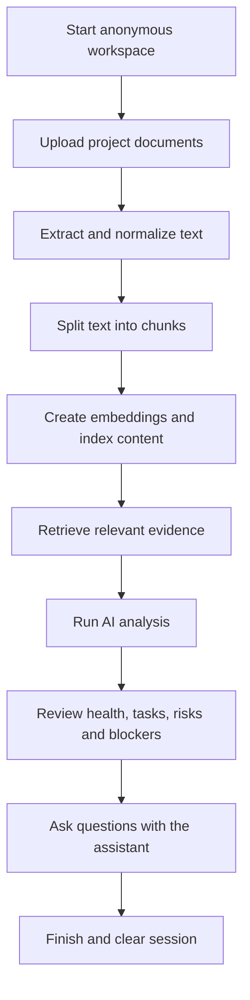

<div align="center">

# AI Project Intelligence & Risk Advisor

### Turn project documents into actionable intelligence.

An AI-powered workspace to analyze project documents, identify risks and blockers, organize action items, and ask evidence-grounded questions using Retrieval-Augmented Generation (RAG).

<p align="center">
  <a href="https://react.dev/" target="_blank">
    
  </a>
  <a href="https://www.typescriptlang.org/" target="_blank">
    
  </a>
  <a href="https://fastapi.tiangolo.com/" target="_blank">
    
  </a>
  <a href="https://python.org/" target="_blank">
    
  </a>
  <a href="https://www.langchain.com/" target="_blank">
    
  </a>
</p>

**Documents → Intelligence → Decisions**

[Repository](https://github.com/Gaganbt03/AI-Project-Intelligence-and-Risk-Advisor) · [Author: Gagan BT](https://github.com/Gaganbt03)

</div>

---

## 📚 Table of Contents

- [Overview](#-overview)
- [Features](#-features)
- [How It Works](#-how-it-works)
- [Technology Stack](#-technology-stack)
- [Getting Started](#-getting-started)
- [Testing](#-testing)
- [Anonymous Workspaces and Cleanup](#-anonymous-workspaces-and-cleanup)
- [API Overview](#-api-overview)
- [Security Notes](#-security-notes)
- [Project Structure](#-project-structure)
- [Limitations](#-limitations)
- [Author](#-author)

## 🔎 Overview

Project work often means reviewing documents, finding requirements, tracking risks, understanding blockers, and coordinating tasks. Doing this manually across multiple files can be slow and error-prone.

**AI Project Intelligence & Risk Advisor** brings these activities into one workspace. Upload project documents, analyze their contents, review the results, and ask questions about the project.

The application is designed around **anonymous, session-isolated temporary workspaces**. Users can start working without a traditional login or manually creating a project.

## ✨ Features

### 📄 Document Upload and Processing

Supported formats:

- PDF (`.pdf`)
- Microsoft Word (`.docx`)
- CSV (`.csv`)
- Plain text (`.txt`)

The pipeline extracts and normalizes text, divides content into chunks, and prepares it for retrieval and analysis.

### 🧠 Project Intelligence

- **Scope and deliverables:** review requirements and deliverables found in source documents.
- **Risk analysis:** inspect potential risks and their supporting information.
- **Blockers and action items:** identify documented issues and follow-up work.
- **Project health:** review available health indicators and analysis results.
- **Generated documents:** access structured project reports and artifacts.
- **Tasks:** organize project-related follow-up activities.

The system is intended to ground findings in uploaded project information. Unsupported details should remain unspecified rather than being presented as confirmed facts.

### 💬 RAG-Powered Assistant

Ask questions about uploaded documents and analysis.

Examples:
- What are the main project deliverables?
- Which risks are mentioned in the documents?
- What blockers need attention?
- Which action items are documented?
- What evidence supports this finding?

The assistant retrieves relevant content and uses it as context for its response. Answer quality depends on the source documents and retrieval results.

### 🧩 Anonymous Temporary Workspaces

- Opens directly into the document workflow.
- Does not require a traditional login flow.
- Uses a server-managed session cookie.
- Scopes workspace data to the current session.
- Enforces workspace ownership on relevant backend routes.
- Provides a **Finish & Clear Session** workflow.

### 🧹 Session Cleanup

The lifecycle is designed to remove temporary workspace data when a session is finished. It includes explicit cleanup, a best-effort browser-close signal, a refresh grace period, and server-side idle expiration.

Browser-close events are not guaranteed to reach the server, so explicit cleanup and server-side expiration remain important.

## 🔄 How It Works



## 🛠️ Technology Stack

| Layer | Technology / Responsibility |
|---|---|
| Frontend | React, TypeScript, Vite |
| Backend | Python, FastAPI |
| Database | SQLite |
| Document processing | PDF, DOCX, CSV, TXT extraction |
| Retrieval | Chunking, embeddings, semantic retrieval |
| Vector storage | Chroma integration |
| AI | Language-model-powered analysis and grounded responses |
| Testing | Pytest, TypeScript checks, production build |

## 🚀 Getting Started

### Prerequisites

- Python compatible with `backend/requirements.txt`
- Node.js and npm
- Git
- AI-provider credentials required by your local configuration

### 1. Clone the repository

```bash
git clone https://github.com/Gaganbt03/AI-Project-Intelligence-and-Risk-Advisor.git
cd AI-Project-Intelligence-and-Risk-Advisor
```

### 2. Set up the backend

Run in PowerShell from the repository root:

```powershell
cd backend
python -m venv .venv
.\.venv\Scripts\Activate.ps1
python -m pip install -r requirements.txt
```

Configure the environment variables documented by the project. If `backend/.env.example` exists, use it as a reference and create your local environment file as needed.

Start the backend:

```powershell
python run.py
```

The development backend is configured to use `http://127.0.0.1:8000`.

### 3. Set up the frontend

Open a **second terminal** from the repository root:

```powershell
cd frontend
npm install
npm run dev
```

Open the local URL printed by Vite. The development frontend is typically available at `http://localhost:5173`.

Keep both the backend and frontend running while using the application.

### 4. Check the frontend

From the `frontend` directory:

```powershell
npm run typecheck
npm run build
```

> **Keep secrets private:** never commit API keys, credentials, production secrets, uploaded user documents, or local database files.

## 🧪 Testing

The backend includes tests for document handling, session lifecycle, workspace isolation, analysis workflows, and API behavior.

From the `backend` directory, activate the virtual environment and run:

```powershell
python -m pytest
```

Focused test commands:

```powershell
python -m pytest tests/test_workspace_lifecycle.py -q
python -m pytest tests/test_documents.py -q
```

Run frontend checks from `frontend`:

```powershell
npm run typecheck
npm run build
```

The full backend suite may take longer than focused groups. A passing targeted test group is **not** proof that the entire suite passes in one run. Verify the complete suite before claiming a full-suite pass.

## 🔐 Anonymous Workspaces and Cleanup

Each workspace is associated with a server-managed anonymous session. Backend routes should verify ownership before returning or changing session-specific resources.

| Method | Endpoint | Purpose |
|---|---|---|
| `POST` | `/api/session/start` | Start an anonymous workspace |
| `GET` | `/api/session/current` | Get current workspace information |
| `POST` | `/api/session/heartbeat` | Record activity for the session |
| `POST` | `/api/session/finish` | Finish and clear the workspace |

Cleanup is designed to remove session-owned project records, uploaded and generated files, analysis records, and related vector-store content. Verify cleanup across the database, filesystem, and vector store.

Browser-close cleanup is best-effort. Server-side idle expiration is intended to handle abandoned sessions.

## 🛡️ Security Notes

The application includes session-isolation mechanisms, but this README is not a security certification. Before public deployment, verify:

- HTTPS and appropriate `Secure`, `HttpOnly`, and `SameSite` cookie settings.
- CSRF and request-origin protections appropriate to the deployment.
- Authorization on **every** route that reads or modifies user-specific data.
- Session cleanup boundaries and recovery from partial cleanup failures.
- Rate limiting, logging, monitoring, and operational alerting.
- Secret storage outside source control.
- Production configuration does not expose development-only settings.

AI-generated findings can be incomplete or incorrect. Review results before using them for important decisions.

## 📁 Project Structure

```text
AI-Project-Intelligence-and-Risk-Advisor/
├── backend/
│   ├── app/
│   │   ├── routers/
│   │   ├── services/
│   │   ├── models_sessions.py
│   │   └── main.py
│   ├── tests/
│   ├── requirements.txt
│   └── run.py
├── frontend/
│   ├── src/
│   │   ├── api/
│   │   ├── components/
│   │   ├── layout/
│   │   ├── pages/
│   │   ├── styles/
│   │   └── workspace/
│   ├── package.json
│   └── vite.config.ts
└── README.md
```

This is a simplified overview; consult the repository for the exact current file tree.

## ⚠️ Limitations

- Results depend on the quality and completeness of uploaded documents.
- Information absent from sources may remain unspecified.
- AI-generated outputs require human review.
- Browser-close cleanup is best-effort; server-side expiration is the fallback.
- Database, file, and vector-store cleanup should be tested for partial failures.
- A successful frontend build does not prove backend security or production readiness.
- Targeted test results do not replace a complete test-suite run.

## 👨‍💻 Author

**Gagan BT**

- GitHub profile: [@Gaganbt03](https://github.com/Gaganbt03)
- Project repository: [AI Project Intelligence & Risk Advisor](https://github.com/Gaganbt03/AI-Project-Intelligence-and-Risk-Advisor)

---

<div align="center">

**AI Project Intelligence & Risk Advisor**  
*Turn project documents into actionable intelligence.*

</div>
